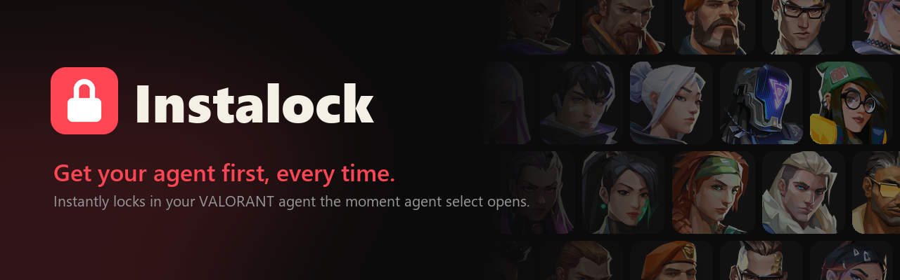
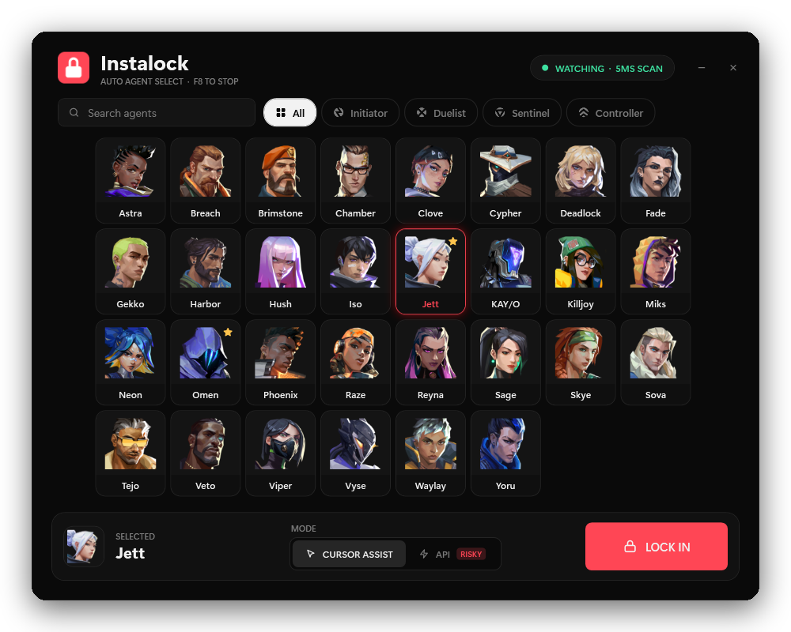
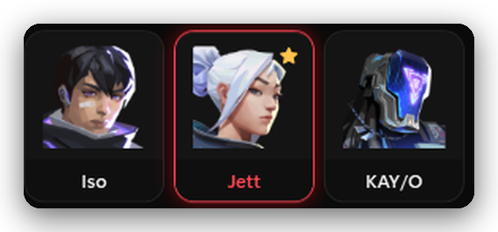
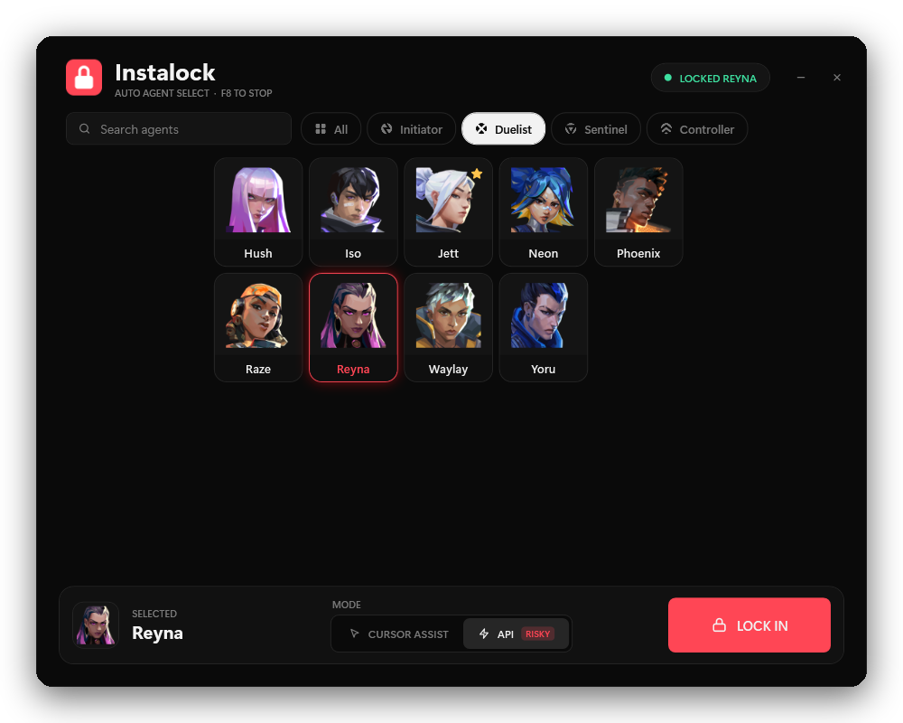
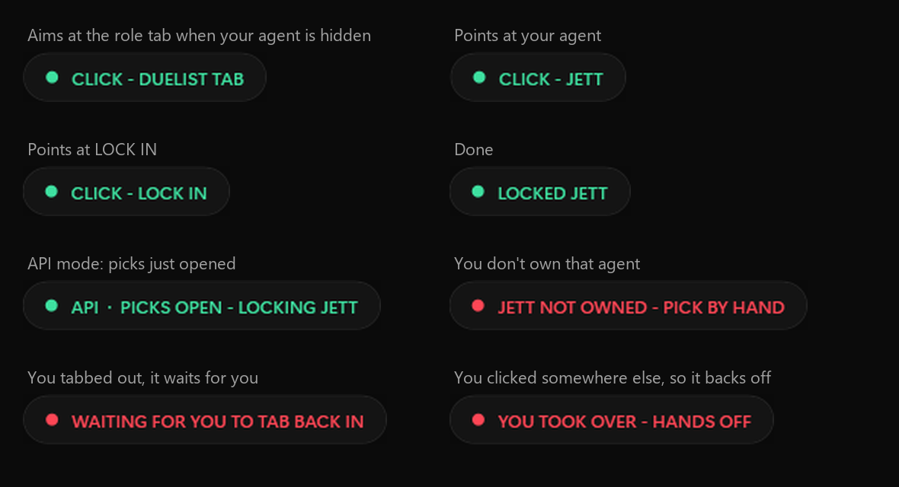

<p align="center">
  
</p>

<p align="center">
  <a href="../../releases/latest"></a>
  
  <a href="LICENSE"></a>
</p>

<p align="center">
  Pick your agent, press <b>LOCK IN</b>, and Instalock grabs them the second agent select opens.
</p>

<p align="center">
  
</p>

## Features

- **Two modes.** Cursor assist moves your mouse and you click. API mode locks for you.
- **Favorites.** Star an agent and Instalock locks them every game until you press STOP.
- **Any setup.** Works at any resolution, on any monitor, and in Deathmatch.
- **Smart.** Skips agents you don't own, waits if you tab out, and backs off if you take over.
- **Light.** Uses about 5 ms of CPU per scan and under 60 MB of RAM.
- **Remembers you.** Your agent, mode, filter and stars come back next time.

## Download

1. Grab `Instalock-vX.Y.Z-win-x64.zip` from the [latest release](../../releases/latest).
2. Unzip it and open `Instalock.exe`. Nothing else to install.

> [!NOTE]
> Windows may show a SmartScreen warning because the app isn't signed. Click **More info → Run anyway**.

## How to use

1. Pick your agent. Search or use the role filters.
2. Choose a mode at the bottom.
3. Press **LOCK IN** and go queue. Instalock waits in the background.
4. Press **F8** to stop at any time, even in game.

### Lock once or every game



By default Instalock locks your agent once and then stops by itself.

Hover over an agent and click the **star** in the corner to make them a favorite. A starred agent gets locked **every game** until you press STOP. You can star as many agents as you want.

<br clear="right">

## Modes

| | 🖱️ Cursor assist | ⚡ API · risky |
|---|---|---|
| **What it does** | Finds agent select on your screen and moves your cursor to your agent, then LOCK IN. **You click.** | Talks to the Riot client on your PC and locks your agent for you. |
| **Speed** | As fast as you click | About 1 second after picks open |
| **Deathmatch** | ✅ | ❌ |
| **Risk** | Lower | Higher |

<p align="center">
  
</p>

## What the status pill means

The pill in the top right always tells you what Instalock is doing.

<p align="center">
  
</p>

## Is this allowed?

> [!WARNING]
> **Use at your own risk.** Riot's rules don't allow third-party tools that automate gameplay, and instalockers count. Instalock doesn't touch game memory, doesn't inject anything and doesn't fake mouse clicks, but API-mode locks are visible to Riot's servers and any account can be banned. Don't use it on an account you'd hate to lose.

## FAQ

<details>
<summary><b>Does it work if I don't own the agent?</b></summary>
<br>
No. Cursor assist sees the padlock and shows <code>NOT OWNED - PICK BY HAND</code>. API mode gets rejected by Riot and tells you to pick by hand.
</details>

<details>
<summary><b>What if someone else takes my agent first?</b></summary>
<br>
Instalock tries a few times, then tells you to pick by hand so you can choose someone else.
</details>

<details>
<summary><b>Will it move my mouse during a match?</b></summary>
<br>
No. It needs to see agent select 3 scans in a row before it does anything, and it only scans the monitor VALORANT is on.
</details>

<details>
<summary><b>What does it save on my PC?</b></summary>
<br>
Agent pictures from <a href="https://valorant-api.com">valorant-api.com</a> are cached in <code>%LOCALAPPDATA%\Instalock\cache</code>. Your settings and stars are saved in <code>%LOCALAPPDATA%\Instalock</code>. Nothing is sent anywhere except Riot (API mode only) and valorant-api.com.
</details>

## Build from source

Needs the [.NET Core 3.1 SDK](https://dotnet.microsoft.com/download/dotnet/3.1) on Windows.

```powershell
dotnet publish -c Release -r win-x64 --self-contained true -p:PublishSingleFile=true -o release
```

<details>
<summary>Built-in checks</summary>
<br>

| Command | What it does |
|---|---|
| `Instalock.exe --selftest` | Loads agent data and checks it |
| `Instalock.exe --findtest testdata\select-duelist.png Jett,Omen` | Runs detection on a screenshot at 720p, 1080p, 1440p and 4K |
| `Instalock.exe --bench` | Measures CPU and memory per scan |
| `Instalock.exe --apitest` | Checks the connection to the Riot client |
| `Instalock.exe --shot out.png [status]` | Saves a picture of the window |

</details>

## License

[MIT](LICENSE)

<sub>Instalock isn't endorsed by Riot Games and doesn't reflect the views or opinions of Riot Games or anyone officially involved in producing or managing Riot Games properties. Riot Games and all associated properties are trademarks or registered trademarks of Riot Games, Inc.</sub>
